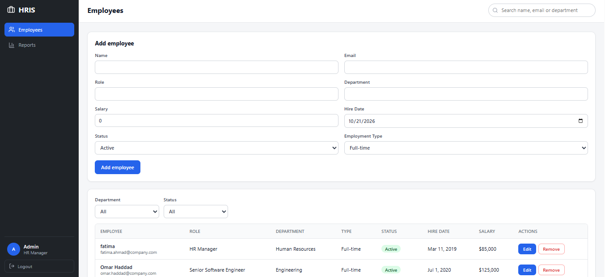
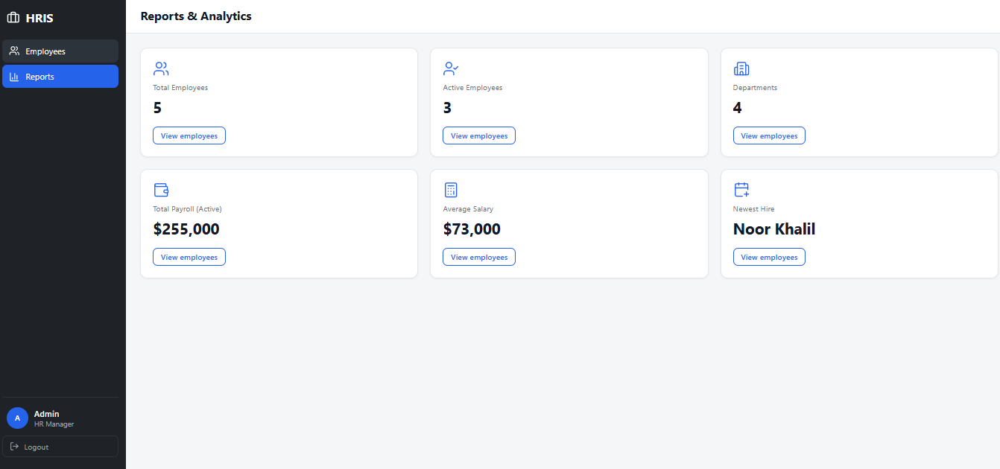

# HRIS – Employee Management System

A full-stack app to manage employees, with login, search, filters and reports.

## Tech Stack

React · TypeScript · ASP.NET Core · Dapper · SQL Server · JWT

## Features

- Secure login with JWT
- Add, edit, delete and search employees
- Filter by department and status
- Reports dashboard

## How to Run

1. Run `database.sql` in SQL Server
2. Backend: `cd server`, then `dotnet user-secrets set "Jwt:Key" "any-long-random-text-64-characters-or-more"`, then `dotnet run`
3. Frontend: `cd client` then `npm install` and `npm run dev`
4. Open http://localhost:5173

**Demo login:** admin@hris.com / Admin123!

## Security

- Passwords are stored only as salted hashes (ASP.NET Core `PasswordHasher`)
- JWT login: signed tokens that expire after 2 hours
- All employee routes require a valid token
- Login is rate-limited (5 attempts per minute per IP) against password guessing
- All SQL uses parameters (no SQL injection)
- Input is validated on both the frontend and the backend
- Security headers, a Content Security Policy and CORS limited to the frontend
- No secrets in the code: the JWT key and connection string come from user-secrets or environment variables
